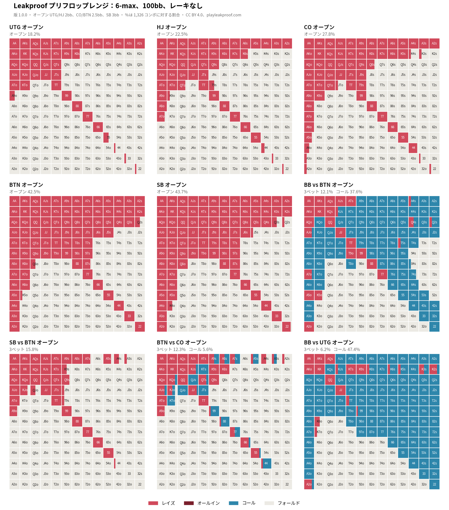

# Leakproof プリフロップレンジ

[English](README.md)

ノーリミット・ホールデムのプリフロップ戦略です。オープン・3ベット・4ベットとそれへの対応を、169 のハンドクラスごとの頻度で収めています。毎日のポーカー問題 [Leakproof](https://playleakproof.com) の問題づくりのために、自前で計算しました。

- ライセンス：[クリエイティブ・コモンズ 表示 4.0 国際（CC BY 4.0）](https://creativecommons.org/licenses/by/4.0/deed.ja)

## ゲーム

ゲームの条件（人数、スタック、レーキ）ごとに、`data/<ゲーム>/<版>/nodes.json` に置いています。

| ゲーム | 人数 | スタック | レーキ | 最新の版 | データ |
|---|---|---|---|---|---|
| `6max-100bb-norake` | 6 | 100bb | なし | 1.0.0（2026-10-31） | [nodes.json](data/6max-100bb-norake/1.0.0/nodes.json) |



6max-100bb-norake 1.0.0 の主なレンジ。ほかの判断（3ベット・4ベットを受けたときなど）は `nodes.json` にあります。

## ライセンスと表示のしかた

このデータは CC BY 4.0 で提供します。商用を含め、コピー・再配布・改変・組み込みが自由にできます。条件は、使うときに次の 3 つを示すことだけです。

1. 出典（Leakproof）と、ゲームと版
2. ライセンス（CC BY 4.0）とそのリンク
3. 改変したときは、改変したこと

表示の例：

> プリフロップレンジ：Leakproof 6max-100bb-norake 1.0.0（https://github.com/a-hanamoto/leakproof-preflop-ranges）、CC BY 4.0（https://creativecommons.org/licenses/by/4.0/deed.ja）。

アプリや記事の中で、画面の下や参考文献の欄など、見つけられる場所に書いてあれば十分です。正式な条文は [LICENSE](LICENSE)（英語）と[リーガルコード（日本語）](https://creativecommons.org/licenses/by/4.0/legalcode.ja)です。

## 無保証

このデータは計算による近似であり、正確さや特定の目的への適合を保証しません。使ったことによる損害について、作成者は責任を負いません（CC BY 4.0 の第 5 条）。

## 版の付け方

版はゲームごとに「メジャー.マイナー.パッチ」の 3 つの数で表します。変更は [CHANGELOG.md](CHANGELOG.md) にまとめます。

- **メジャー**：同じゲームで、木（額やアクション）を変えたとき。前の版とは別の戦略です
- **マイナー**：木は同じで、計算をやり直したとき。頻度が変わります
- **パッチ**：頻度は変えず、ファイルの形や説明を直したとき

## 頻度の丸め方

頻度は、**ペアは 1/6 単位、それ以外は 25% 単位**に丸めています。ソルバーの答えそのままの頻度（「このハンドは 11% だけ 3ベット」など）は、人が覚えたり、実際のテーブルで使い分けたりできないためです。

単位をハンドの種類で変えているのは、1 単位をちょうどコンボの数にそろえるためです。

| ハンド | コンボの数 | 単位 | 1 単位 |
|---|---|---|---|
| ペア（`22` など） | 6 | 1/6（約 17%） | 1 コンボ |
| スーテッド（`AKs` など） | 4 | 25% | 1 コンボ |
| オフスート（`AKo` など） | 12 | 25% | 3 コンボ |

こうしておくと、乱数を使わなくても、スートで混ぜ方を決められます。たとえば「AKs を 25% で 3ベット」は「スペードの AKs だけ 3ベット」、「99 を 1/3 でコール」は「6 コンボのうち、決めた 2 つだけコール」にできます。

丸めたことによる損は、どの席でも 100 ハンドあたり 1bb 未満でした（UTG 0.0、HJ +0.1、CO +0.5、BTN −0.8、SB +0.8、BB −0.6。計算の誤差は ±0.3〜0.4）。丸めたあとは、ほかの判断を解き直してあります。

| スポット | 丸める前 | 丸めた版（このデータ） |
|---|---|---|
| UTG / HJ / CO / BTN / SB オープン | 18.4 / 22.7 / 27.8 / 42.5 / 43.6% | 18.2 / 22.5 / 27.8 / 42.5 / 43.7% |
| BB vs BTN：コール / 3ベット | 36.5 / 13.5% | 37.6 / 12.1% |
| BB vs UTG：コール | 47.2% | 47.4% |
| SB vs BTN：3ベット | 15.8% | 15.8% |
| BTN vs CO：コール / 3ベット | 5.6 / 12.2% | 5.6 / 12.3% |

（％はハンドの組み合わせ 1,326 通りに対する割合）

## データの形（`nodes.json`）

1 対 1 の判断ごとのリストです。判断ごとに、それまでの流れ、選べるアクション、ハンドクラスごとの頻度を持っています。

```json
{
  "line": "SB raise 3bb",
  "history": [0, 0, 0, 0, 1],
  "actor": "BB",
  "raises": 1,
  "pot_bb": 4.0,
  "to_call_bb": 2.0,
  "actions": ["fold", "call", "raise 9bb", "allin"],
  "classes": {
    "AA": {"reach": 1, "strategy": [0, 0, 1, 0]},
    "32o": {"reach": 1, "strategy": [1, 0, 0, 0]}
  }
}
```

| 項目 | 中身 |
|---|---|
| `line` | ここまでの自発的なアクション（フォールドは省く）。最初の判断は空 |
| `history` | 最初からのすべてのアクションの番号（各判断の `actions` の何番目か。フォールドも含む） |
| `actor` | 手番のポジション |
| `raises` | ここまでのレイズの回数（0 = オープン前、1 = オープンを受けた、2 = 3ベットを受けた、…） |
| `pot_bb`、`to_call_bb` | ポットと、コールに要る額（bb） |
| `actions` | 選べるアクション。`raise 9bb` は合計 9bb へのレイズ |
| `classes` | ハンドクラス（`AKs`、`AKo`、`22` など）ごとの値。この判断に来うるクラス（`reach` が 0 より大きいもの）だけを入れ、来ないクラスは省いているので、後の判断ほど 169 より少なくなります |
| `reach` | 手番のプレイヤーが、自分のそれまでの行動でこの判断まで来る割合（0〜1） |
| `strategy` | この判断での各アクションの頻度（`actions` と同じ順、合計 1） |

自発的に参加しているのが 2 人以下の判断だけを収めています。3 人目が入りうるところ（オープンに BTN がコールしたあとの BB など）は、フォールドした場合だけをたどっているので、その場面はファイルにありません。

## 6max-100bb-norake

| 項目 | 条件 |
|---|---|
| 人数 | 6 人（UTG、HJ、CO、BTN、SB、BB） |
| スタック | 全員 100bb |
| ブラインド | SB 0.5bb、BB 1bb。アンティなし |
| レーキ | なし |
| オープン | UTG・HJ 2bb、CO・BTN 2.5bb、SB 3bb。リンプなし（SB も） |
| オープンへのコール | BTN と BB だけ（ほかのポジションはレイズかフォールド） |
| 3ベット | IP はオープンの 3 倍、SB は 4.5 倍、BB は 5.5 倍 |
| 3ベットへのコール | すでにお金を入れたプレイヤーだけ（3ベットへのコールドコールなし） |
| 4ベット | IP は 3ベットの 2.1 倍、OOP は 2.65 倍 |
| 5ベット以降 | オールインだけ |
| オールイン | レイズを受けたすべての判断で選べる（3ベット・4ベット・コールの代わりのオールイン） |
| オープンでのオールイン | なし |

額は 0.5bb 単位に丸めています。1.0.0 の判断は 78 個です。

## 限界

- **近似です**：フロップ以降を毎回解いて決めた戦略ではなく、フロップ以降の結果を近似して解いています
- **木を絞っています**：上の表にない額やアクション（オープンのオールイン、3ベットへのコールドコール、リンプなど）は考えていません
- **レーキなし**：実際のゲームはレーキでタイトになります

## 問い合わせ

X：[@playleakproof](https://x.com/playleakproof)
