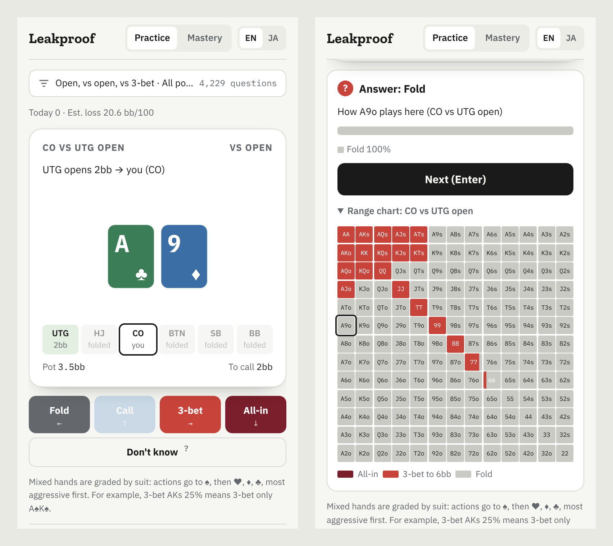
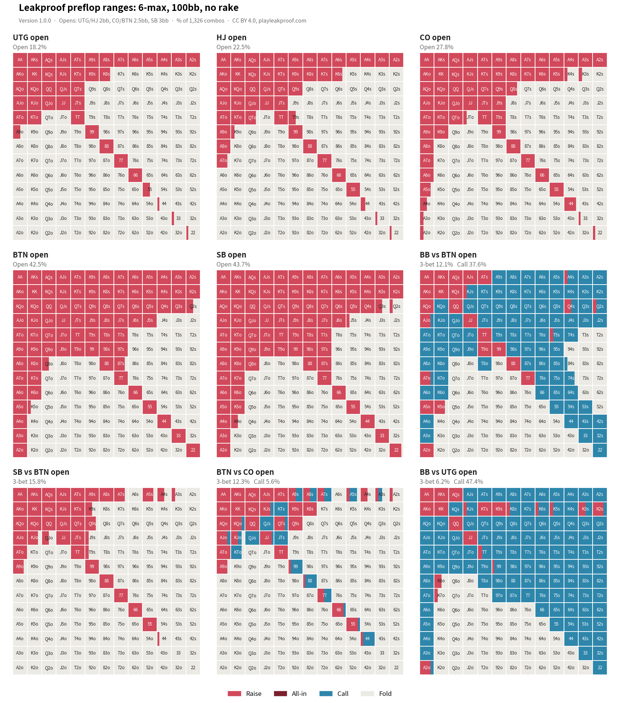

# Leakproof preflop ranges

[日本語](README.ja.md)

Preflop strategy for No-Limit Hold'em: opens, 3-bets, 4-bets and the responses to them, as frequencies for each of the 169 hand classes. We computed it ourselves to build the puzzles of [Leakproof](https://playleakproof.com), a daily poker puzzle.

- License: [Creative Commons Attribution 4.0 International (CC BY 4.0)](https://creativecommons.org/licenses/by/4.0/)
- Charts: every decision as a page at [playleakproof.com/preflop](https://playleakproof.com/preflop/) (Japanese: [/ja/preflop](https://playleakproof.com/ja/preflop/)). Pick whose range (the player at the decision, or the opponent's range that got there), the actions and the weights (this decision only, or with the player's earlier actions), and copy it as range text (`AA,AKs,A5s:0.25`, weights 0–1) for solvers and range tools.
- Practice: [Leakproof Preflop Range Trainer](https://playleakproof.com/trainer/) drills these ranges in the browser. Answer by swiping; it estimates how well you know each hand and spot, and asks most what you are likely to miss. Free, no sign-up.



## Games

Each game (players, stacks, rake) has its own folder: `data/<game>/<version>/nodes.json`.

| Game | Players | Stacks | Rake | Latest version | Data |
|---|---|---|---|---|---|
| `6max-100bb-norake` | 6 | 100bb | none | 1.0.0 (2026-10-31) | [nodes.json](data/6max-100bb-norake/1.0.0/nodes.json) |



Main ranges of 6max-100bb-norake 1.0.0. The other decisions (facing a 3-bet or a 4-bet, and so on) are in `nodes.json`.

## License and attribution

The data is licensed under CC BY 4.0. You may copy, redistribute, adapt and build it into anything, commercial use included. The only condition is that you give:

1. the source (Leakproof), the game and the version,
2. the license (CC BY 4.0) with a link to it,
3. a note that you changed it, if you did.

Example:

> Preflop ranges: Leakproof 6max-100bb-norake 1.0.0 (https://github.com/a-hanamoto/leakproof-preflop-ranges), CC BY 4.0 (https://creativecommons.org/licenses/by/4.0/).

A line at the bottom of the screen, or in the references of an article, is enough. The legal text is in [LICENSE](LICENSE).

## No warranty

The data is a computed approximation. It comes with no warranty of accuracy or fitness for any purpose, and the authors are not liable for any loss from its use (Section 5 of CC BY 4.0).

## Versions

Each game has its own versions, MAJOR.MINOR.PATCH. Changes are listed in [CHANGELOG.md](CHANGELOG.md).

- **MAJOR**: the same game with a different tree (sizes or actions). A different strategy.
- **MINOR**: the same tree, computed again. Frequencies change.
- **PATCH**: the same frequencies; only the file format or the documentation changes.

## Rounding

Frequencies are rounded to **steps of 1/6 for pairs and 25% for all other hands**. The solver's raw frequencies ("3-bet this hand 11% of the time") cannot be remembered or carried out at a real table.

The step differs by hand type so that one step is always a whole number of combos:

| Hands | Combos | Step | One step |
|---|---|---|---|
| Pairs (`22`, ...) | 6 | 1/6 (about 17%) | 1 combo |
| Suited (`AKs`, ...) | 4 | 25% | 1 combo |
| Offsuit (`AKo`, ...) | 12 | 25% | 3 combos |

A mix can then be played by suits, with no random number: "3-bet AKs 25%" becomes "3-bet only AKs of spades", and "call 99 one third of the time" becomes "call with two chosen combos of the six".

Rounding costs every seat less than 1bb per 100 hands (UTG 0.0, HJ +0.1, CO +0.5, BTN −0.8, SB +0.8, BB −0.6; the estimate's error is ±0.3 to 0.4). The other decisions were solved again after rounding.

| Spot | Before rounding | Rounded (this data) |
|---|---|---|
| UTG / HJ / CO / BTN / SB open | 18.4 / 22.7 / 27.8 / 42.5 / 43.6% | 18.2 / 22.5 / 27.8 / 42.5 / 43.7% |
| BB vs BTN: call / 3-bet | 36.5 / 13.5% | 37.6 / 12.1% |
| BB vs UTG: call | 47.2% | 47.4% |
| SB vs BTN: 3-bet | 15.8% | 15.8% |
| BTN vs CO: call / 3-bet | 5.6 / 12.2% | 5.6 / 12.3% |

(% of the 1,326 starting combos)

## The file (`nodes.json`)

A list of the heads-up decisions. Each has the line so far, the actions, and the frequencies by hand class.

```json
{
  "line": "SB raise 3bb",
  "history": [0, 0, 0, 0, 1],
  "actor": "BB",
  "raises": 1,
  "pot_bb": 4.0,
  "to_call_bb": 2.0,
  "actions": ["fold", "call", "raise 9bb", "allin"],
  "classes": {
    "AA": {"reach": 1, "strategy": [0, 0, 1, 0]},
    "32o": {"reach": 1, "strategy": [1, 0, 0, 0]}
  }
}
```

| Field | Meaning |
|---|---|
| `line` | The voluntary actions so far (folds left out). Empty for the first decision |
| `history` | Every action from the start, as its index in that decision's `actions` (folds included) |
| `actor` | The seat to act |
| `raises` | Raises so far (0 = unopened, 1 = facing an open, 2 = facing a 3-bet, ...) |
| `pot_bb`, `to_call_bb` | The pot and the amount to call, in bb |
| `actions` | The actions. `raise 9bb` is a raise to 9bb in total |
| `classes` | Values by hand class (`AKs`, `AKo`, `22`, ...): only the classes that can reach this decision (`reach` above 0). Hands that cannot get here are left out, so later decisions list fewer than 169 |
| `reach` | How often the actor's own earlier actions bring this hand here (0 to 1) |
| `strategy` | How often the hand takes each action here (in the order of `actions`; sums to 1) |

Only decisions with at most two players in by choice are included. Where a third player could come in (the BB after an open and a BTN call, for example), only the fold is followed, so those spots are not in the file.

## 6max-100bb-norake

| Parameter | Value |
|---|---|
| Players | 6 (UTG, HJ, CO, BTN, SB, BB) |
| Stacks | 100bb each |
| Blinds | SB 0.5bb, BB 1bb, no ante |
| Rake | none |
| Opens | UTG and HJ 2bb, CO and BTN 2.5bb, SB 3bb. No limps (SB included) |
| Calling an open | BTN and BB only (other seats raise or fold) |
| 3-bets | 3x the open in position, 4.5x from the SB, 5.5x from the BB |
| Calling a 3-bet | only players who have already put money in (no cold calls of 3-bets) |
| 4-bets | 2.1x the 3-bet in position, 2.65x out of position |
| 5-bets and later | all-in only |
| All-ins | also an option at every decision facing a raise (a shove instead of the 3-bet, 4-bet or call) |
| Open shoves | none |

Sizes are rounded to 0.5bb. Version 1.0.0 has 78 decisions.

## Limitations

- **An approximation.** The strategy is not the result of solving every postflop spot; the result after the flop is approximated.
- **A narrow tree.** Sizes and actions not in the table above (open shoves, cold calls of 3-bets, limps) are not considered.
- **No rake.** Real games play tighter because of rake.

## Contact

X: [@playleakproof](https://x.com/playleakproof)
